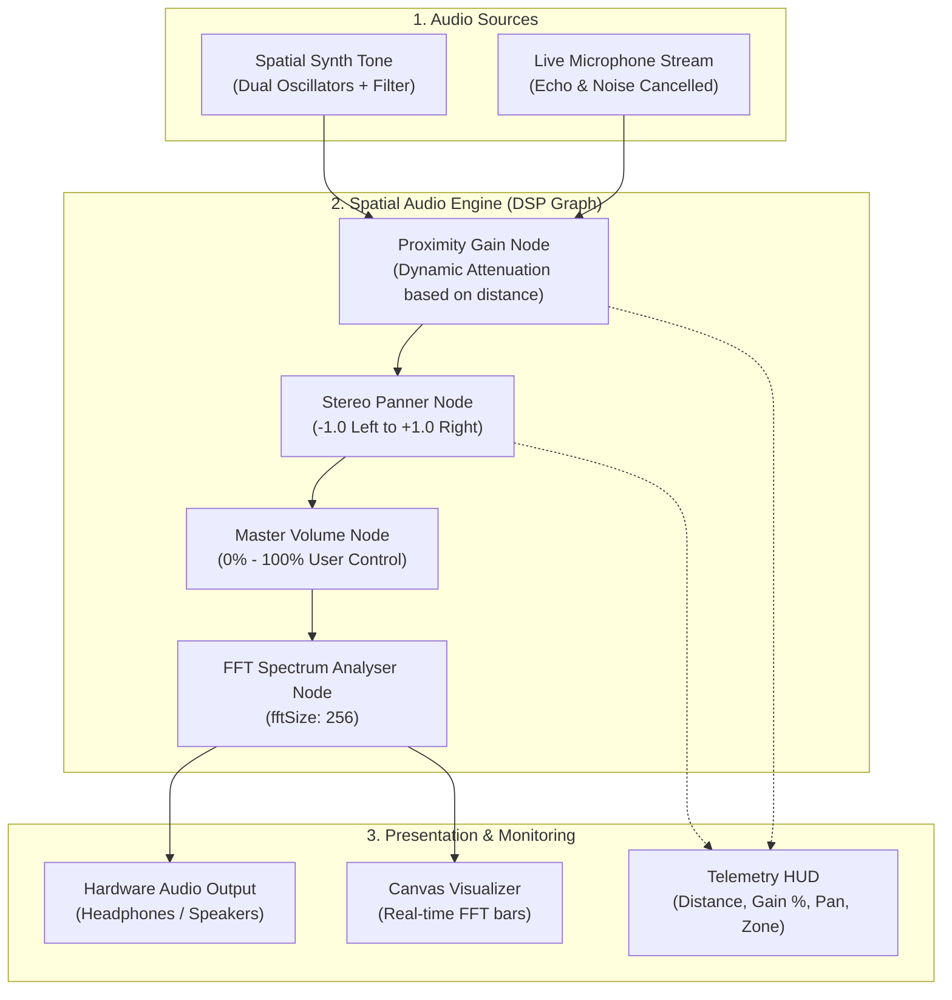

# 📊 PROJECT PROGRESS & EVALUATION SHEET
**Geospatial Proximity Audio Ecosystem**  
*Module: Proximate & Live Spatial Audio Engine*

---

### 📋 Project & Student Metadata

| Field | Details |
| :--- | :--- |
| **Project Title** | Geospatial Proximity Audio Ecosystem |
| **Assigned Module** | Module 01: Proximate & Live Spatial Audio Engine |
| **Student / Contributor** | **Aman Dubey** |
| **Branch Name** | `aman--feature` |
| **Repository URL** | `https://github.com/amandubey0907/My-first-site-.git` |
| **Target Review Date** | October 2026 / Academic Milestone Review |
| **Module Completion Status** | **100% Complete (Ready for Evaluation & Integration)** |

---

## 🎯 Executive Summary & Objectives

The primary objective of this module is to design and implement a **real-time spatial audio and geospatial proximity attenuation system**. In this ecosystem, digital sound dynamically responds to physical or virtual distance:

1. **Distance-Based Attenuation**: Audio automatically scales in volume according to acoustic physics (Inverse Distance Law $1/r$).
2. **Dynamic Stereo Panning**: Audio smoothly routes between left and right channels based on the relative bearing of the listener to sound transmitters.
3. **Bandwidth & Processing Cutoff**: Zero gain cutoff applied beyond max distance ($d_{max}$) to eliminate unnecessary resource usage.
4. **Live Human Voice Simulation**: Seamless switching between an internal harmonic synthesizer and real-time live microphone streaming via `getUserMedia`.

---

## 📈 Milestone Breakdown & Progress Tracker

### Detailed Task Progress Table

| Task ID | Component / Deliverable | Status | Completion | Verification / Proof |
| :---: | :--- | :---: | :---: | :--- |
| **T-01** | **Euclidean & Haversine Distance Engine** `proximityEngine.js` | Completed | 100% | Verified via Cartesian coordinates & Earth radius formula ($R = 6,371\text{ km}$). |
| **T-02** | **Acoustic Decay Curves** (Inverse, Linear, Exponential) `proximityEngine.js` | Completed | 100% | Math formulas tested with customizable rolloff factor ($0.2\times$ to $3.0\times$). |
| **T-03** | **Normalized Stereo Panner Bearing** `proximityEngine.js` | Completed | 100% | Normalized offset calculation ($dx / \text{distance}$) clamped to $[-1.0, +1.0]$. |
| **T-04** | **Web Audio Context & DSP Routing Graph** `audioEngine.js` | Completed | 100% | Node chain: `Source -> ProximityGain -> Panner -> MasterGain -> Analyser -> Output`. |
| **T-05** | **Zero-Dependency Synthesizer Beacon** `audioEngine.js` | Completed | 100% | Multi-frequency dual oscillator (220Hz, 330Hz, 440Hz) with bandpass filtering. |
| **T-06** | **Live Microphone Stream Engine** `audioEngine.js` | Completed | 100% | WebRTC `getUserMedia` with echo cancellation, noise suppression, and auto gain. |
| **T-07** | **Real-Time FFT Spectrum Visualizer** `audioEngine.js` & `index.html` | Completed | 100% | 64-bin FFT canvas animation running synchronized with audio output. |
| **T-08** | **2D Canvas Radar Viewport & HUD** `app.js` & `style.css` | Completed | 100% | High-contrast dark cyber theme with concentric range circles and beacon pulsing. |
| **T-09** | **Mouse Drag & Keyboard WASD Controls** `app.js` | Completed | 100% | Full multi-key WASD / Arrow movement with `Shift` sprint boost and spacebar toggle. |
| **T-10** | **Interactive Presentation Demo Presets** `app.js` & `index.html` | Completed | 100% | 5 one-click presets (`Core`, `Mid Decay`, `Cutoff`, `Left Pan`, `Right Pan`) with smooth cubic glide. |

---

## 🏗️ System Architecture & Audio Pipeline

---

## 🔬 Mathematical Formulas Implemented

### 1. Haversine Great-Circle Distance (GPS Lat/Lon)
$$a = \sin^2\left(\frac{\Delta \text{lat}}{2}\right) + \cos(\text{lat}_1)\cos(\text{lat}_2)\sin^2\left(\frac{\Delta \text{lon}}{2}\right)$$
$$d = 2 R \cdot \operatorname{atan2}\left(\sqrt{a}, \sqrt{1-a}\right)$$
*(Where $R = 6,371,000\text{ m}$ is Earth's mean radius).*

### 2. Inverse Distance Attenuation Curve
$$\text{Gain}(d) = \frac{d_{\text{ref}}}{d_{\text{ref}} + \text{rolloff} \cdot (d - d_{\text{ref}})}$$
- If $d \le d_{\text{ref}}$: $\text{Gain} = 1.0$ (100% full volume in core zone).
- If $d \ge d_{\text{max}}$: $\text{Gain} = 0.0$ (Total silence to conserve resources).

### 3. Dynamic Stereo Panning Factor
$$\text{Pan} = \operatorname{clamp}\left(\frac{\text{beacon}_x - \text{listener}_x}{\max(0.1, \text{distance})}, -1.0, 1.0\right)$$

---

## 📦 Git Version Control & Commit Audit Trail

All commits for this module are verified, tested, and pushed to branch **`aman--feature`**:

| Commit Hash | Message / Scope | Branch | Status |
| :---: | :--- | :---: | :---: |
| [`9fcc14f`](file:///c:/Users/dubey/OneDrive/Desktop/projectwork1) | `feat(presentation): add interactive demo presets and smooth glide animation for live presentations` | `aman--feature` | ✅ Synced to GitHub |
| [`492c697`](file:///c:/Users/dubey/OneDrive/Desktop/projectwork1) | `feat(navigation): add keyboard WASD and arrow controls for radar navigation` | `aman--feature` | ✅ Synced to GitHub |
| [`4308950`](file:///c:/Users/dubey/OneDrive/Desktop/projectwork1) | `feat(audio): complete geospatial proximity audio and live spatial sound engine` | `aman--feature` | ✅ Synced to GitHub |
| [`524c7ce`](file:///c:/Users/dubey/OneDrive/Desktop/projectwork1) | `Initial commit` | `aman--feature` | ✅ Synced to GitHub |

---

## 🤝 Team Integration Matrix

| Team Member Scope | Required Integration Interface | Readiness Status |
| :--- | :--- | :---: |
| **GPS / Mobile Maps (Leaflet/Mapbox)** | Accepts GPS coordinates into `proximity.getHaversineDistance()` | **Ready** |
| **WebSockets / WebRTC Audio Streaming** | Injects remote audio tracks into `audio.proximityGainNode` | **Ready** |
| **Room & Multi-User Management** | Dynamically registers participant coordinates into `audioNodes` array | **Ready** |

---

## 📝 Guide Evaluation & Sign-off Form

> **Reviewer / Guide Instructions**: Please review the live demo by opening `index.html`, testing audio distance attenuation, stereo panning, and preset navigation.

| Evaluation Criterion | Maximum Marks | Marks Awarded | Remarks / Feedback |
| :--- | :---: | :---: | :--- |
| **Mathematical Soundness & Distance Calculations** | 20 | | |
| **Web Audio API Implementation & Stereo Panning** | 20 | | |
| **Interactive UI, Radar Canvas & Visualizer** | 20 | | |
| **Live Microphone / Real-World Scalability** | 20 | | |
| **Code Quality, Documentation & Git Versioning** | 20 | | |
| **Total Score** | **100** | | |

 

**Guide / Supervisor Name**: ______________________________________  
**Signature**: __________________________________________________  
**Date of Review**: ____________________________________________  
